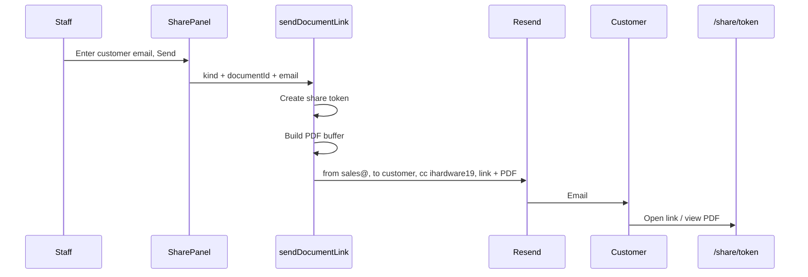

# Document view + email from sales@

## Locked decisions

- **View:** Improve the public [`/share/[token]`](src/app/share/[token]/page.tsx) experience (not an in-Ops PDF preview).
- **Send:** Email includes the **share link + PDF attachment**, **From** `sales@ihe.co.zw`, always **CC** `ihardware19@gmail.com`.



## 1. Public share page — clearer viewing

Update [`src/app/share/[token]/page.tsx`](src/app/share/[token]/page.tsx):

- Use [`brand`](src/lib/brand.ts) for company name, address, phones, email so the page feels like an IHE document, not a bare summary.
- Keep the existing HTML line summary + accept-quote flow.
- Add an **inline PDF viewer** (`iframe` / `object` pointing at `/share/${token}/pdf`) so customers can read the letterheaded PDF without downloading first.
- Keep **Download PDF** as a secondary action.
- Slightly widen the shell (e.g. `max-w-3xl`) so the PDF is readable on desktop; stack fine on mobile.

No new routes — reuse [`src/app/share/[token]/pdf/route.ts`](src/app/share/[token]/pdf/route.ts).

## 2. Shared PDF builder for email attachments

Extract a small helper (e.g. `buildSharePdf(kind, documentId)` in `src/lib/share-pdf.ts` or next to document-export) that returns `{ filename, buffer }` using the same `exportQuote` / `exportInvoice` / `exportReceipt` + `mapSellLines` logic already in the share PDF route.

- Refactor the share PDF route to call that helper (no behaviour change).
- Call the same helper from [`sendDocumentLink`](src/actions/shares.ts) when an email address is provided.

## 3. Email: From, CC, link + attachment

Update [`src/actions/shares.ts`](src/actions/shares.ts):

```ts
from: process.env.RESEND_FROM || "Infinite Hardware & Electrical <sales@ihe.co.zw>",
to: email,
cc: "ihardware19@gmail.com",
subject: `Your ${kind} from Infinite Hardware & Electrical`,
text: `Please find your ${kind} attached. You can also view it online: ${url}`,
attachments: [{ filename, content: buffer }],
```

- Default From becomes sales@ (env can still override via `RESEND_FROM`).
- Always CC `ihardware19@gmail.com` when sending.
- If PDF build fails after the link is created, return the URL with an error that the link is ready but the email/attachment did not send (same pattern as today).

Update [`.env.example`](.env.example):

```env
RESEND_FROM=Infinite Hardware & Electrical <sales@ihe.co.zw>
```

Document that the Resend domain for `ihe.co.zw` must be verified for `sales@` to send.

## 4. Share panel copy

In [`src/components/share-panel.tsx`](src/components/share-panel.tsx):

- Label / button: treat email as the primary path (“Send to customer” when email filled; still allow blank email to only create a link).
- Success copy can note that the PDF was emailed (when no error).

No schema/migration changes.