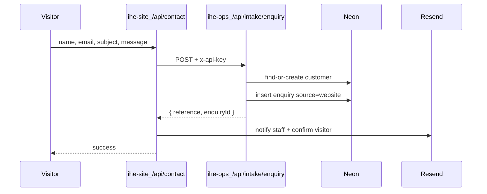

# Website → Ops enquiry intake

## Goal

When someone submits the contact form on [ihe-site](file:///Users/malcolmmachiri/Documents/projects/ihe-site), create a real `new` enquiry in [ihe-ops](file:///Users/malcolmmachiri/Documents/projects/ihe-ops) (with find-or-create customer), while keeping the existing Resend emails as backup/confirmation.



## Defaults locked in

- Server-to-server call from site → Ops (not shared DB access from the public site).
- Auth: shared `INTAKE_API_KEY` via `x-api-key` header.
- If Ops intake fails, site still sends the current Resend emails so the lead is not lost, and returns success to the visitor (Ops failure is logged).
- No new contact form fields in this pass (name / email / subject / message only).
- Enquiry `source` value: `website`. `assignedTo` left null.

## 1. Ops — public intake API

Add [`src/app/api/intake/enquiry/route.ts`](file:///Users/malcolmmachiri/Documents/projects/ihe-ops/src/app/api/intake/enquiry/route.ts):

- `POST` JSON: `{ name, email, title?, message }` (title = subject from the site).
- Reject unless `request.headers.get("x-api-key") === process.env.INTAKE_API_KEY`.
- Validate with a small Zod schema (reuse patterns from [`src/lib/schemas.ts`](file:///Users/malcolmmachiri/Documents/projects/ihe-ops/src/lib/schemas.ts)).
- Find customer by lowercased email; if none, insert into `customers` with `name` + `email`.
- Insert enquiry via existing numbering (`nextDocumentNumber(db, "ENQ")` from [`src/lib/numbers.ts`](file:///Users/malcolmmachiri/Documents/projects/ihe-ops/src/lib/numbers.ts)):
  - `title`: subject or truncated message / `"Website enquiry"`
  - `description`: full message
  - `source`: `"website"`
  - `status`: `"new"`
  - `urgency`: `"normal"`
- Return `{ reference, enquiryId, customerId }`.

## 2. Ops — allow unauthenticated intake

Update [`src/proxy.ts`](file:///Users/malcolmmachiri/Documents/projects/ihe-ops/src/proxy.ts) public matcher:

```ts
const isPublicRoute = createRouteMatcher([
  "/sign-in(.*)",
  "/sign-up(.*)",
  "/share(.*)",
  "/api/intake(.*)",
]);
```

API-key check on the route remains the real gate.

## 3. Ops — recognize `website` as a source

- Extend `enquirySchema` source enum in [`src/lib/schemas.ts`](file:///Users/malcolmmachiri/Documents/projects/ihe-ops/src/lib/schemas.ts) with `"website"`.
- Add Website option in [`src/components/record-forms.tsx`](file:///Users/malcolmmachiri/Documents/projects/ihe-ops/src/components/record-forms.tsx) source choices.
- No DB migration: `enquiries.source` is already `varchar`.

## 4. Ops — env

Add to [`.env.example`](file:///Users/malcolmmachiri/Documents/projects/ihe-ops/.env.example):

```env
INTAKE_API_KEY=
```

## 5. Site — call Ops from contact

Update [`src/app/api/contact/route.ts`](file:///Users/malcolmmachiri/Documents/projects/ihe-site/src/app/api/contact/route.ts):

- Accept `subject` separately in the JSON body (today the page folds it into `message` as `[subject] …`).
- Update [`src/app/contact/page.tsx`](file:///Users/malcolmmachiri/Documents/projects/ihe-site/src/app/contact/page.tsx) to send `{ name, email, subject, message }`.
- After validation, `POST` to `${OPS_INTAKE_URL}/api/intake/enquiry` with `x-api-key: OPS_INTAKE_API_KEY`.
- On Ops success, include the `ENQ-…` reference in the staff notification email.
- On Ops failure: `console.error`, continue with existing Resend notify + confirm flow.

Add site env (document in README or a new `.env.example` if missing):

```env
OPS_INTAKE_URL=https://ops.example.com
OPS_INTAKE_API_KEY=
```

Local: point `OPS_INTAKE_URL` at the Ops dev origin (port from Ops README, currently `43127`).

## 6. Verify

- Submit contact form against local Ops with matching keys → new customer (or match) + enquiry with `source=website` on `/enquiries`.
- Wrong/missing API key → 401 from Ops; site still emails.
- Staff can open the enquiry and continue sourcing/quote as today.
